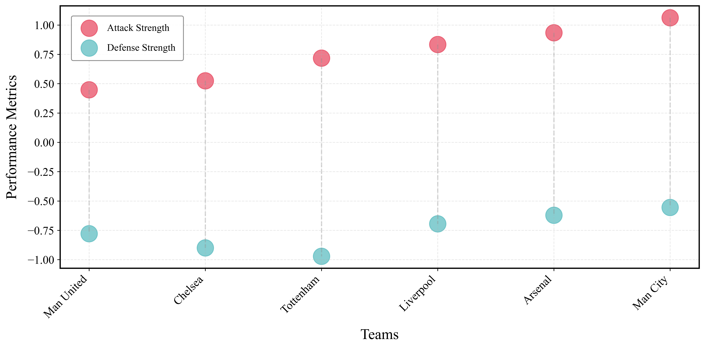

# PROBE: Premier League Bayesian Analysis

PROBE (Poisson-Regressed Observations of Big-Six Evolution) studies English Premier League results from 1993-94 to 2023-24 with Poisson and hierarchical Bayesian models.

The project estimates team-level attack and defence strengths, quantifies home advantage, simulates league outcomes, and tracks how competitive structure has changed across three decades.



## Highlights

- Hierarchical Bayesian Poisson model with partial pooling and sum-to-zero constraints.
- Season-level attack and defence estimates with uncertainty intervals.
- Posterior predictive simulation for points, title, top-four, and relegation probabilities.
- Longitudinal comparison of home advantage and in-sample outcome accuracy.
- Interactive browser dashboard in [`index.html`](index.html).
- Full 15-page project report in [`report/STAT451_final_report.pdf`](report/STAT451_final_report.pdf).

Selected findings reported in the paper:

- Estimated home advantage peaked around the turn of the millennium and fell sharply in the empty-stadium 2020-21 season.
- In-sample outcome accuracy generally increased over time, consistent with greater competitive stratification.
- The 1993-94 model separates distinct team profiles, including Arsenal's defence-led strength and Newcastle United's attack-led strength.

These findings are descriptive and model-dependent. The accuracy series is evaluated in-sample and should not be interpreted as out-of-sample forecasting performance.

## Repository structure

```text
.
|-- assets/                         # Dashboard and README images
|-- data/
|   |-- raw/                        # Source match dataset
|   |-- processed/                  # Season-level and goal-filtered CSV files
|   `-- scripts/                    # Data preparation scripts
|-- model/poisson/
|   |-- lambdas/                    # Estimated parameters and comparison figures
|   |-- posterior_predictive/       # Posterior predictive summaries
|   |-- scripts/                    # MLE and Bayesian modelling code
|   `-- visualize/                  # Visualisation code
|-- report/                         # Final course report
|-- index.html                      # Interactive dashboard
`-- requirements.txt
```

## Quick start

1. Create and activate a Python environment.
2. Install dependencies:

   ```bash
   pip install -r requirements.txt
   ```

3. Rebuild the goal-filtered seasonal data if needed:

   ```bash
   python data/scripts/filter_goal_data.py
   ```

4. Run an estimator:

   ```bash
   python model/poisson/scripts/mle-L-BFGS-B.py
   python model/poisson/scripts/mle-LS.py
   ```

5. Open `model/poisson/scripts/Bayes.ipynb` for the hierarchical Bayesian workflow and posterior predictive simulation.

The Bayesian workflow can be computationally expensive. Generated NetCDF trace files are intentionally excluded from version control; rerunning the notebook recreates them locally.

## Dashboard

The dashboard reads the committed season-level parameter CSV files. Serve the repository root with any static HTTP server, for example:

```bash
python -m http.server 8000
```

Then open `http://localhost:8000`.

## Data source

The match data are derived from Michael Panagopoulos, *English Premier League & Championship Full Dataset*, Kaggle (accessed 29 July 2025). See the report for the full citation and modelling references.

## Author

Jiarui Jiang - STAT4510J Final Project, Shanghai Jiao Tong University.

## License and reuse

No open-source license is currently granted. The repository is public for portfolio and academic-review purposes. Third-party data remain subject to their original terms.
